Caching is one of the hardest things to get right. There are two hard things in Comp-Sci: Naming variables and caching

On the surface caching is quite simple. You keep a copy of some data somewhere so you don't have to query the database or compute it again. In practice we have to decide what to cache and where, how long it stays fresh and what happens when it goes stale. Get any of these steps wrong and you're either going to end up serving stale data or saturating your database with requests until it can't handle it anymore. There are many ways to get caching right and it depends entirely upon your product's workload. A read-heavy API that serves the same response to everyone and an API that serves personalised responses to each user need entirely different caching strategies.

## Why should we cache in the first place?

Most caches, such as Redis and Memcached, are in-memory stores. When you ask Redis for a key, it reads that data straight from RAM. A database such as Postgres keeps its data on disk (SSD or HDD). It keeps the pages it uses often in memory, but anything that isn't already there has to be read from disk.

| Operation                    | Rough time           |
| ---------------------------- | -------------------- |
| Read from RAM                | ~100 nanoseconds     |
| Random read from an NVMe SSD | ~20-100 microseconds |
| Random read from an HDD      | ~2-10 milliseconds   |

That makes a RAM read roughly 1,000x faster than a random read from an SSD, and up to 100,000x faster than a hard drive. In practice a call to Redis also has a network round trip, which usually takes a fraction of a millisecond inside the same data centre. That's still far faster than a query that has to go to a disk.

In addition to this speed up, even with a heavily optimised setup (read replicas, PgBouncer etc.), our database will only be able to handle so many requests before its CPU and memory are saturated and it can no longer return data quickly. Even if your database isn't getting hammered, you might notice that a page takes 5 seconds to load. That might be because there's an expensive database call being made or the database is busy serving other queries. Today we're going to focus on adding caching to a struggling system.

## How to introduce caching

A lot of people slap Redis on top of a database without first understanding why they are doing so. We have to be very careful with a few aspects here.

### Measure bottlenecks

The first thing is identifying the bottleneck. There's no point caching something if you haven't found the root cause, as caching may not end up solving it.

Start with what your users are seeing. A tracing tool such as Datadog or Sentry can show you which parts of your application are slow and break the request down into parts (is the frontend slow? is the feed service slow?). You might find the cause is the database or perhaps a third-party API taking a long time to respond.

If the database is the problem, find out what queries are costing you the most. In Postgres, the `pg_stat_statements` extension can help you keep track of every query the database runs. Here we're going to find the top 10 most expensive queries:

```sql
SELECT query, calls, total_exec_time, mean_exec_time
FROM pg_stat_statements
ORDER BY total_exec_time DESC
LIMIT 10;
```

It's important to order by `total_exec_time` here. A query that takes 2 seconds but only runs a few times a day matters far less than a 100ms query that runs 50k times a minute.

We'll then get a result such as:

```
                          query                         |  calls  | total_exec_time | mean_exec_time
--------------------------------------------------------+---------+-----------------+----------------
 SELECT * FROM products WHERE id = $1                   | 4812330 |      8854687.20 |           1.84
 SELECT p.id, avg(r.rating) FROM products p JOIN ...    |  912044 |      5754997.64 |           6.31
 SELECT count(*) FROM orders WHERE user_id = $1 AND ... | 1503221 |      4464566.37 |           2.97
 SELECT * FROM categories ORDER BY position             | 3320118 |      3054508.56 |           0.92
 SELECT date_trunc($1, created_at), sum(total) FROM ... |    1440 |      3030552.00 |        2104.55
(5 rows)
```

The slowest query here is the last one, a daily sales report that takes over 2 seconds each time it runs. But it only runs 1,440 times, and it's at the bottom of the list. The query costing the most is a simple product lookup that takes under 2 milliseconds. It runs nearly 5 million times, which adds up to almost 2.5 hours of database time. It's also cheap, read-heavy and shared by every user, which makes it the perfect thing to cache.

After you've fixed the slow queries, it's worth looking at the database itself via something such as the AWS console (CloudWatch and RDS Performance Insights). There you'll get a good overview of the core metrics we care about. High CPU, high memory, lots of disk I/O or connections hitting the limit tell you the database is running out of resources and it's time to scale up the instance.

Caching without solving query speed will just hide the problem and come back to bite you when the cache is invalidated. This isn't a complete list but before reaching for a cache make sure to check:

- Missing indexes: Run `EXPLAIN ANALYZE` on a slow query. For example, a sequential scan over a big table can often be fixed with one index.
- N+1 queries: A page that runs one query per item in a list will be slow. Batch them into one instead.
- Don't over-fetch data: Avoid using `SELECT *` and only select the data a request actually needs.

This will usually solve most of the slowdowns you see in your database.

## Time to cache

Now that we've done the above and optimised our database, let's cache some stuff.

Remember the product lookup at the top of our `pg_stat_statements` results? It runs nearly 5 million times, returns the same data to every user, and the product only changes when someone edits it. That makes it our first candidate. Instead of asking Postgres for the product every time, which puts a lot of strain on our database, let's keep a copy in the cache and only go to the database when the cache doesn't have it.

## Caching strategies

Where do we cache these products?

A caching strategy typically comes down to two questions: where does the cache live, and how does it stay in sync with the database?

### Client-side caching

Client-side caching is where either your app or browser keeps a copy of the response, using HTTP cache headers or something such as local storage. This is great as there's no network round trip, there are little to no network calls to our servers and it's super fast.

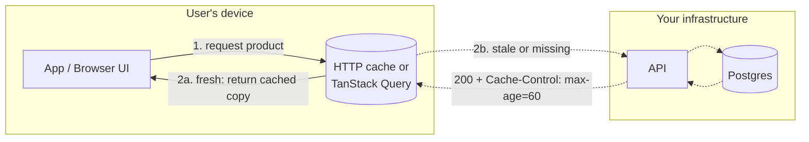

1. Cache-control headers: There are a few ways to control how your browser/app caches a response. The server sends a `Cache-Control` header with the response, e.g. `Cache-Control: public, max-age=60`. The most commonly used ones are:

- `max-age={seconds}`: How long a response stays fresh before the browser requests it again
- `public`: Anything is allowed to cache this, including CDNs
- `private`: Only the user's browser can cache this. Use this for personalised data such as a user's social media feed (we don't want to serve one user's data to another)
- `no-cache`: The browser can store it but it first has to check with the server before using it
- `no-store`: Don't cache it anywhere. Use this for ephemeral or sensitive data such as payment details or health checks

2. stale-while-revalidate: Let's say we display a page for a clothing company (e.g. ASOS) for all users. We could send a header such as `Cache-Control: public, max-age=60, stale-while-revalidate=300`. After 60 seconds the browser keeps showing the cached clothes for up to 5 minutes while it fetches a fresh copy in the background. The user gets an instant response (ideally from a CDN close to them) and the fresh data catches up moments later.

3. ETags: When the server first sends a response, it can include an `ETag` header. An `ETag` is a fingerprint of the response, i.e. a hash of the body or a version number built from something such as `updated_at`. When the cached copy expires, the browser doesn't throw it away. It sends the request again with the ETag in an `If-None-Match` header. If nothing has changed, the server replies with an empty `304 Not Modified` response and the browser keeps using its copy. We still pay for the round trip, but we don't send the whole payload again. If we can work out the ETag cheaply (from a version column, for example), we can skip the expensive query too.

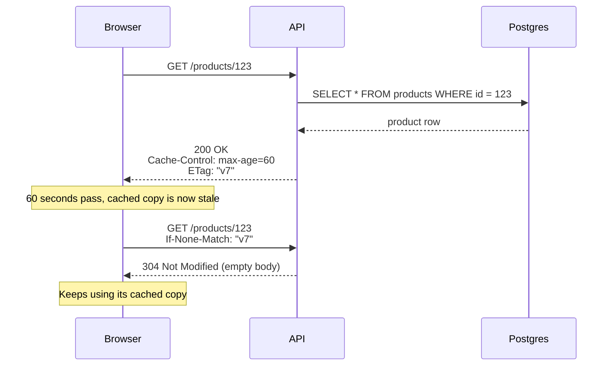

4. Caching in the app itself: Libraries such as TanStack Query or SWR cache the result of each request against a key (a `queryKey` in TanStack Query) and share the cached result between components/pages. If three pages need the same data, the app can make one request instead of three. By default this cache lives in memory. With a persister you can save it to local storage in the browser, or to the phone's disk in a mobile app (via MMKV or SQLite).

Pros:

- Little to no network round trips
- Requests almost never reach your servers/database
- Works offline if you persist the cache
- Mostly free - little to no leg work, the browser and headers are doing most of the work for you

Cons:

- Invalidation gets tricky. Once a response is on someone's device it stays there until it expires.
- Only helps repeat requests from the same user. 100k users viewing a product page will first get the uncached version if they haven't visited the page before
- Easy to leak personalised / sensitive data if you mark a response `public` by mistake
- Every user can end up having a different version of the data, making bugs harder to reproduce

Use cases:

- Static assets - reusing images the browser has already downloaded
- Data that rarely changes (categories in a shopping website for example)
- Data a user loads again and again in the lifetime of their session (e.g. settings, profile)
- Mobile apps that need to work offline or need to have a very low TTI (time to interactive)

### In-memory caching

Pros:

In-memory caching is wonderful. It lets you skip the complexity of setting up something like Redis or Memcached entirely and it can be really effective. The servers our backend services run on usually have lots of spare memory. So we can use that spare memory to cache data right alongside the process our server is running in. This is one of the fastest kinds of caching. We don't have to go and make an expensive network hop to Redis to get our cached data, since it's already there on our server!

Cons:

Unlike external caches, each server has its own copy of the cache. It's quite common to horizontally scale servers these days. So if `server 1` caches something in memory, `server 2` and `server 3` won't have it. This can lead to inconsistencies, uneven load and wasted memory.

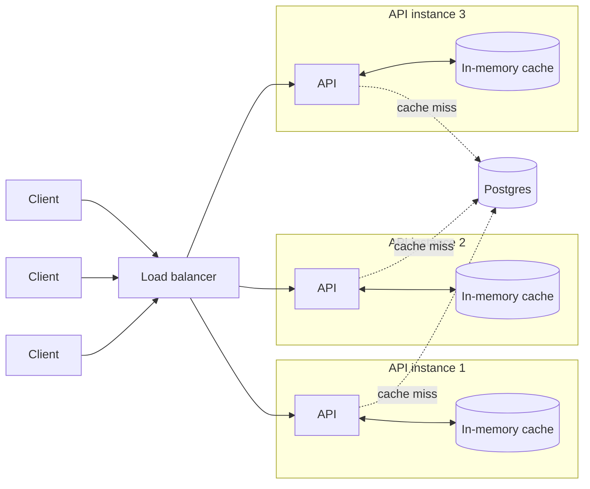

Use cases:

- Config data
- Small lookup tables that every request relies on. If you're not familiar, a lookup table is a small table that holds a list of valid values. Other tables typically point to it via an FK (foreign key) and don't store the value as text in every row.

For example:

```sql
CREATE TABLE order_statuses (
  id   SMALLINT PRIMARY KEY,
  name TEXT NOT NULL UNIQUE
);

INSERT INTO order_statuses (id, name) VALUES
  (1, 'pending'),
  (2, 'paid'),
  (3, 'shipped'),
  (4, 'cancelled');

CREATE TABLE orders (
  id        BIGSERIAL PRIMARY KEY,
  user_id   BIGINT NOT NULL,
  status_id SMALLINT NOT NULL REFERENCES order_statuses(id),
  total     NUMERIC(10, 2) NOT NULL
);
```

Since the order status lookup table in our example is very small and we need it for every order request, it makes sense to cache it rather than make a query each time.

C# example:

```csharp
public class OrderStatusLookup
{
    public FrozenDictionary<int, string> ById { get; private set; } = FrozenDictionary<int, string>.Empty;

    public async Task LoadAsync(AppDbContext db) =>
        ById = (await db.OrderStatuses.AsNoTracking().ToListAsync())
            .ToFrozenDictionary(s => s.Id, s => s.Name);
}

builder.Services.AddSingleton<OrderStatusLookup>();

var app = builder.Build();

using (var scope = app.Services.CreateScope())
{
    var db = scope.ServiceProvider.GetRequiredService<AppDbContext>();
    await app.Services.GetRequiredService<OrderStatusLookup>().LoadAsync(db);
}
```

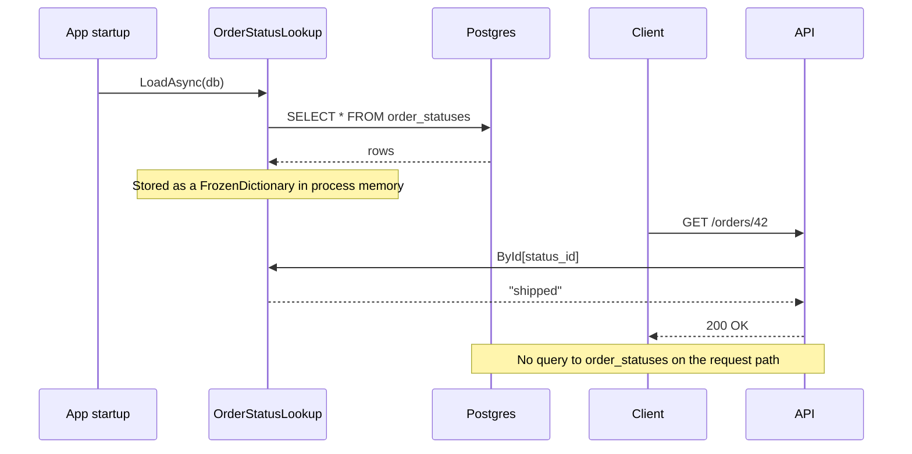

### Cache-aside

This is the most popular way of caching data. It is by far the simplest and hardest to get wrong. I recommend this most of the time.

When we use cache-aside, our application is responsible for caching. The cache never talks to the database. Our code acts as a middleman and decides when to read from and write to either the database or the cache. For every request we:

1. Check the cache. We provide a key such as `products` or `product:123`. If Redis has it (a cache hit), we return it to the user.
2. If Redis doesn't have the data (cache miss), we query our database as we normally would. But before we return a response to the user, we cache the data in Redis for next time.
3. Writing to the database: When a product is updated, we update the database and then delete the key from Redis.

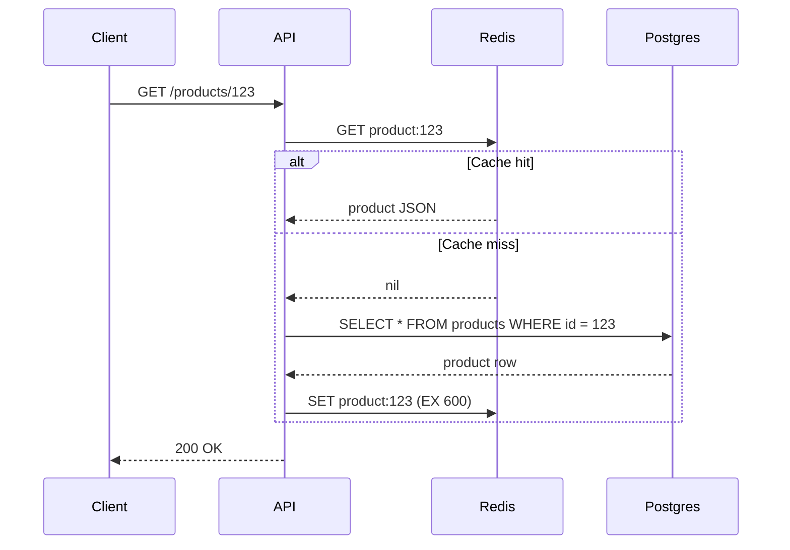

C# example:

```csharp
public class ProductService(AppDbContext db, IConnectionMultiplexer redis)
{
    private static readonly TimeSpan Ttl = TimeSpan.FromMinutes(10);

    public async Task<Product?> GetAsync(int id)
    {
        var cache = redis.GetDatabase();
        var key = $"product:{id}";

        var cached = await cache.StringGetAsync(key);
        if (cached.HasValue)
        {
            return JsonSerializer.Deserialize<Product>(cached!);
        }

        var product = await db.Products.AsNoTracking().FirstOrDefaultAsync(p => p.Id == id);
        if (product is null)
        {
            return null;
        }

        await cache.StringSetAsync(key, JsonSerializer.Serialize(product), Ttl);
        return product;
    }

    public async Task UpdateAsync(Product product)
    {
        db.Products.Update(product);
        await db.SaveChangesAsync();

        // delete the old entry in cache since we've changed it in the db
        // next request will get a cache miss
        await redis.GetDatabase().KeyDeleteAsync($"product:{product.Id}");
    }
}
```

Pros:

- Simple. The logic is easy to understand and easy to write in any language
- Only data that people actually request ends up in the cache, making our cache very lean.
- If Redis or our database goes down, we can still serve some form of data (service degradation rather than an outage)

Cons:

- Every first request is slow, because it has to go to the database
- Data can become stale if you don't manage your caching logic properly
- Cache stampede. When a popular key expires, every request in flight misses the cache at the same time and they all hit the database together. We'll cover this in more detail in the Cache stampedes section

Use cases:

- Read heavy workloads that many users request, such as our product lookup
- Data where a short period of stale data is fine (product details, categories, public profiles)
- Expensive DB queries or third-party API calls that you don't want to repeat on every request

### Write-through

Write-through caching is a bit more complex than cache-aside. Open source Redis and Memcached don't support it natively (at the time of writing), so you need to find a framework or library (or invent your own) that does. It needs to understand when to trigger your DB write logic automatically.

In write-through caching, the server writes directly to the cache _first_ and then the cache writes the data to the database before it returns it to the user. The _write_ is not considered complete until both the cache and database have been successfully updated.

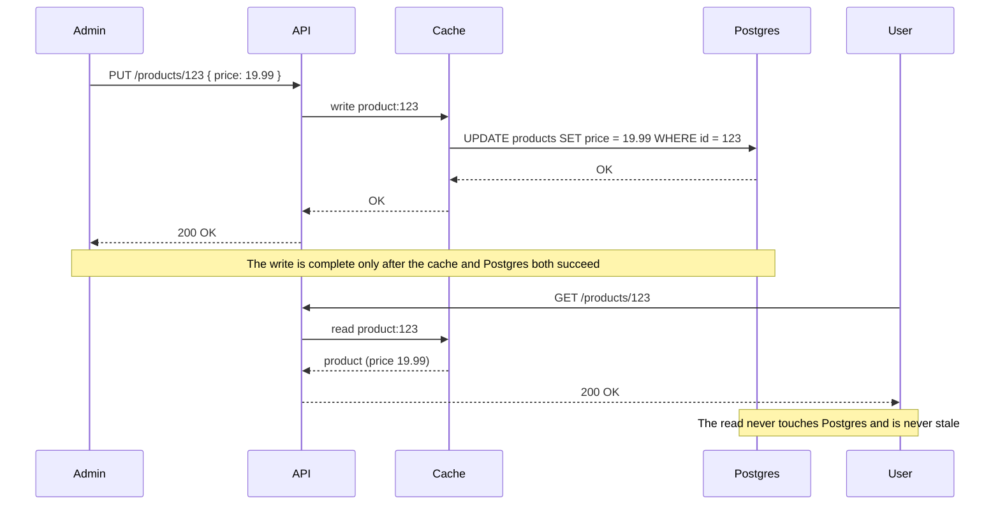

Pros:

- Reads always return the freshest data
- No lost writes. A write is only confirmed once it's in the database, so the cache crashing never results in data loss. This is why it's used for mission-critical workloads (financial data etc.)
- If the database goes down, reads can still be served from the cache (writes will fail until it's back)

Cons:

- Slower writes because you need to wait for both the cache and DB to be updated
- Pollutes your cache with data that may never be read again, eating up precious memory and leading to possible evictions
- Suffers from something known as the 'dual-write' problem. If the cache update succeeds but the database write fails (or vice versa), then we enter an inconsistent state. The cache has the right value but the database doesn't (or vice versa). To prevent this, you need very comprehensive retry logic and error handling. 100% consistency is quite complicated to achieve which is why I don't recommend this approach unless preventing data loss is extremely important for the product.

Use cases:

- Values that need to be 100% fresh and correct when they're shown, such as stock levels in a shop
- Data a user reads straight after writing it (with freshness being paramount)

C# example:

```csharp
public class WriteThroughProductStore(
    AppDbContext db,
    IConnectionMultiplexer redis,
    ILogger<WriteThroughProductStore> logger)
{
    private static readonly TimeSpan Ttl = TimeSpan.FromHours(1);

    private static readonly ResiliencePipeline Retry = new ResiliencePipelineBuilder()
        .AddRetry(new RetryStrategyOptions
        {
            ShouldHandle = new PredicateBuilder()
                .Handle<RedisConnectionException>()
                .Handle<RedisTimeoutException>()
                .Handle<NpgsqlException>(ex => ex.IsTransient),
            MaxRetryAttempts = 3,
            BackoffType = DelayBackoffType.Exponential,
            Delay = TimeSpan.FromMilliseconds(200),
            UseJitter = true,
        })
        .Build();

    public async Task UpdatePriceAsync(int id, decimal price, CancellationToken ct = default)
    {
        var cache = redis.GetDatabase();
        var key = $"product:{id}";

        var product = await db.Products.FirstAsync(p => p.Id == id, ct);
        product.Price = price;

        await Retry.ExecuteAsync(
            async _ => await cache.StringSetAsync(key, JsonSerializer.Serialize(product), Ttl), ct);

        try
        {
            await Retry.ExecuteAsync(async token => await db.SaveChangesAsync(token), ct);
        }
        catch (Exception ex)
        {
            logger.LogError(ex, "Database write failed for {Key}, rolling back the cache", key);
            await RollBackCacheAsync(cache, key);
            throw;
        }
    }

    private async Task RollBackCacheAsync(IDatabase cache, string key)
    {
        try
        {
            await Retry.ExecuteAsync(async _ => await cache.KeyDeleteAsync(key), CancellationToken.None);
        }
        catch (Exception ex)
        {
            logger.LogCritical(ex, "Could not roll back {Key}, the cache holds a value the database does not", key);
        }
    }
}
```

### Write-behind (write-back)

Write-behind (or write-back) caching is very similar to write-through caching. Instead of updating the database synchronously, the cache writes to the database asynchronously in the background. So our server writes to the cache, but then the cache flushes those updates to the database in batches. This makes writes much faster than write-through caching.

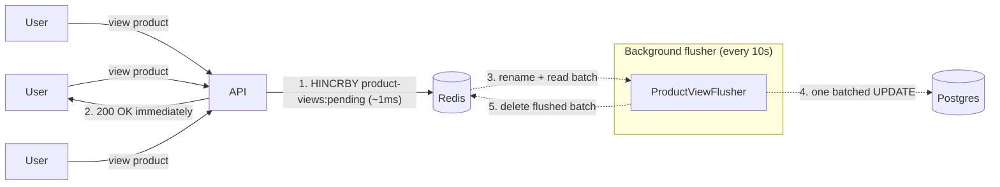

Pros:

- Low write latency
- Reduced DB load - by batching multiple queries into a single transaction
- Fault tolerance - if the DB goes down, we can still accept and queue updates in the cache

Cons:

- If the cache crashes or fails before flushing updates to the DB, we lose that data
- The database is always a little behind the cache, so anything that reads from the database (reports, other services) sees old data

Use cases:

- Where high write throughput is more important than immediate/close-to-immediate consistency
- Analytics and metrics pipelines where a bit of data loss is acceptable

C# example:

```csharp
public class ProductViewCounter(IConnectionMultiplexer redis)
{
    public const string PendingKey = "product-views:pending";

    public Task RecordViewAsync(int productId) =>
        redis.GetDatabase().HashIncrementAsync(PendingKey, productId);
}

public class ProductViewFlusher(
    IConnectionMultiplexer redis,
    IServiceScopeFactory scopes,
    ILogger<ProductViewFlusher> logger) : BackgroundService
{
    private const string FlushingKey = "product-views:flushing";
    private static readonly TimeSpan Interval = TimeSpan.FromSeconds(10);

    protected override async Task ExecuteAsync(CancellationToken ct)
    {
        using var timer = new PeriodicTimer(Interval);

        do
        {
            try
            {
                await FlushAsync(ct);
            }
            catch (Exception ex) when (ex is not OperationCanceledException)
            {
                logger.LogError(ex, "Flush failed, retrying on the next tick");
            }
        } while (await timer.WaitForNextTickAsync(ct));
    }

    private async Task FlushAsync(CancellationToken ct)
    {
        var cache = redis.GetDatabase();

        if (!await cache.KeyExistsAsync(FlushingKey))
        {
            if (!await cache.KeyExistsAsync(ProductViewCounter.PendingKey))
            {
                return;
            }

            await cache.KeyRenameAsync(ProductViewCounter.PendingKey, FlushingKey);
        }

        var entries = await cache.HashGetAllAsync(FlushingKey);
        var ids = entries.Select(e => (int)e.Name).ToArray();
        var views = entries.Select(e => (long)e.Value).ToArray();

        using var scope = scopes.CreateScope();
        var db = scope.ServiceProvider.GetRequiredService<AppDbContext>();

        await db.Database.ExecuteSqlAsync($"""
            UPDATE products p
            SET view_count = p.view_count + v.views
            FROM unnest({ids}, {views}) AS v(id, views)
            WHERE p.id = v.id
            """, ct);

        await cache.KeyDeleteAsync(FlushingKey);
    }
}

builder.Services.AddSingleton<ProductViewCounter>();
builder.Services.AddHostedService<ProductViewFlusher>();

app.MapGet("/products/{id:int}", async (int id, ProductViewCounter views, ProductService products) =>
{
    await views.RecordViewAsync(id);
    return await products.GetAsync(id);
});
```

### Read-through

Read-through caching is very similar to cache-aside. The cache handles the database lookup instead of our application code. We first try to read from the cache. If we get a cache miss, the cache goes and requests the data from our DB, stores it in cache and returns it to the server. The difference from cache-aside is that our cache acts as a proxy (similar to how CDNs work).

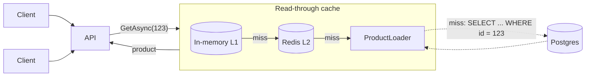

Pros:

- Simplified logic - since the cache layer deals with this for you
- Better read scalability, as the cache layer can coalesce requests during cache misses. Some read-through caches can also refresh entries before they expire (refresh-ahead)

Cons:

- Increased latency on first cache miss
- Higher complexity in the cache layer since it now owns the cache and db access, leading to stale data if not invalidated properly
- May cache data that is rarely read, bloating the cache

Use cases:

- Read-heavy workloads - data that is read often and updated rarely
- Dashboards and analytics
- User profiles
- Lookup tables

C# example:

```csharp
public interface IDataLoader<TValue>
{
    Task<TValue?> LoadAsync(int id, CancellationToken ct);
}

public class ProductLoader(AppDbContext db) : IDataLoader<Product>
{
    public Task<Product?> LoadAsync(int id, CancellationToken ct) =>
        db.Products.AsNoTracking().FirstOrDefaultAsync(p => p.Id == id, ct);
}

public class ReadThroughCache<TValue>(HybridCache cache, IDataLoader<TValue> loader)
{
    private static readonly string Prefix = typeof(TValue).Name.ToLowerInvariant();

    public async Task<TValue?> GetAsync(int id, CancellationToken ct = default) =>
        await cache.GetOrCreateAsync(
            $"{Prefix}:{id}",
            (loader, id),
            static (state, token) => new ValueTask<TValue?>(state.loader.LoadAsync(state.id, token)),
            cancellationToken: ct);

    public ValueTask InvalidateAsync(int id) => cache.RemoveAsync($"{Prefix}:{id}");
}
```

```csharp
builder.Services.AddStackExchangeRedisCache(options =>
    options.Configuration = builder.Configuration.GetConnectionString("Redis"));

builder.Services.AddHybridCache(options =>
    options.DefaultEntryOptions = new HybridCacheEntryOptions
    {
        Expiration = TimeSpan.FromMinutes(10),
        LocalCacheExpiration = TimeSpan.FromMinutes(1),
    });

builder.Services.AddScoped<IDataLoader<Product>, ProductLoader>();
builder.Services.AddScoped(typeof(ReadThroughCache<>));

app.MapGet("/products/{id:int}", async (int id, ReadThroughCache<Product> products, CancellationToken ct) =>
    await products.GetAsync(id, ct) is { } product ? Results.Ok(product) : Results.NotFound());
```

### CDNs

A CDN (content delivery network) is a geographically distributed network of servers that can cache content close to your user. In this form of caching, we're optimising for network latency. Without a CDN every single request has to travel from your origin server to your user. Let's say we have an S3 bucket hosted in `eu-west-2` (London) and our end user is all the way in Australia 🦘, a single network round trip between London and Sydney takes around 250ms. With a CDN on the other hand, that same request might hit an edge server in Sydney that's just a few miles away from them and come back in 10-20ms.

When a user requests something such as an image or static JS, instead of that request hitting your origin server, it goes to the nearest CDN edge server and if the image is already cached there, it's returned immediately. If a cache miss occurs, the CDN will go and fetch that data from your origin server (S3 for example) and return it to the CDN. The CDN will then cache that for future requests and return it back to the client.

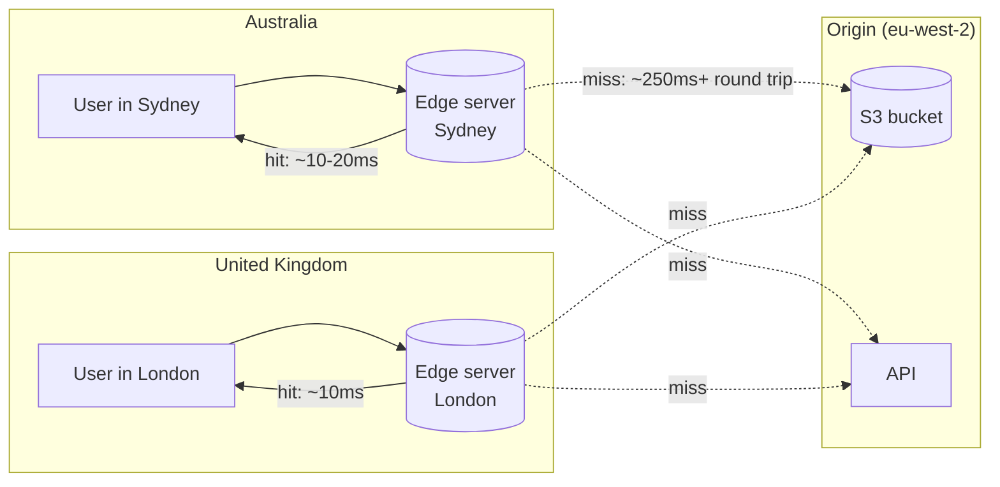

Modern CDNs can do much more than just caching images or static files though. We can use them to cache API responses or run edge logic (personalisation based on the user's location).

Pros:

- Much lower latency for users far away from your origin server
- Takes load off your origin. Most requests for static files or public API responses never reach your servers
- Absorbs traffic spikes and gives you some protection against DDoS attacks, since the edge takes the traffic before it gets to you. I've covered this in more detail in my [DDoS blog post](/blog/ddos-attacks-and-how-to-prevent-them-with-cloudflare-aws-api-gateway)
- Can lower your bandwidth costs, as serving from the edge is often cheaper than serving from your origin

Cons:

- Invalidation is slow. Purging a file can take seconds to minutes to reach every edge server, and some CDNs charge you for it
- Each edge server has its own cache. Users in regions with low traffic hit a cold cache more often and still pay the round trip to your origin
- Harder to debug. When a user sees stale data, you have to work out if it came from the browser, the CDN or your server cache. Headers such as `Age` and `X-Cache` help here
- Another service to pay for and configure

Use cases:

- Static assets such as JS, CSS, images, fonts and videos
- Public API responses that are the same for every user, such as product pages or a product catalogue
- Products with users all over the world
- Traffic spikes you can plan for, such as a product launch or Black Friday
- Logic at the edge, such as redirects based on location, A/B tests or rejecting unauthenticated requests before they reach your origin

C# example:

To cache an API response at the CDN, the origin tells the CDN how long to keep it with the `Cache-Control` header. `s-maxage` applies only to shared caches such as CDNs, so we can keep a response at the edge for an hour but tell the browser to check again after a minute:

```csharp
app.MapGet("/products/{id:int}", async (int id, ReadThroughCache<Product> products, HttpContext http, CancellationToken ct) =>
{
    var product = await products.GetAsync(id, ct);
    if (product is null)
    {
        return Results.NotFound();
    }

    http.Response.Headers.CacheControl = "public, max-age=60, s-maxage=3600, stale-while-revalidate=300";
    return Results.Ok(product);
});

app.MapGet("/me/basket", async (BasketService baskets, HttpContext http, CancellationToken ct) =>
{
    http.Response.Headers.CacheControl = "private, no-store";
    return Results.Ok(await baskets.GetForCurrentUserAsync(ct));
});
```

On CloudFront, the distribution only respects these headers if its cache policy allows it, for example the managed `UseOriginCacheControlHeaders` policy. Otherwise CloudFront uses its own TTLs.

When a product changes, we have to purge it from every layer. Here we update the database, invalidate our own cache and then ask CloudFront to invalidate the path:

```csharp
public class CdnInvalidator(IAmazonCloudFront cloudFront, IConfiguration config)
{
    public Task InvalidateAsync(params string[] paths) =>
        cloudFront.CreateInvalidationAsync(new CreateInvalidationRequest
        {
            DistributionId = config["CloudFront:DistributionId"],
            InvalidationBatch = new InvalidationBatch
            {
                CallerReference = Guid.NewGuid().ToString(),
                Paths = new Paths { Quantity = paths.Length, Items = [.. paths] },
            },
        });
}

app.MapPut("/products/{id:int}", async (
    int id,
    UpdateProductRequest request,
    ProductService products,
    ReadThroughCache<Product> cache,
    CdnInvalidator cdn) =>
{
    await products.UpdateAsync(id, request);
    await cache.InvalidateAsync(id);
    await cdn.InvalidateAsync($"/products/{id}");

    return Results.NoContent();
});
```

## Cache eviction policies

One trade-off with caching something is that caches are limited. We only have so much memory before we run out. So, when new data comes in, we need a strategy to decide what to remove. This is called an eviction policy.

1. LRU (least recently used) - Evict items that haven't been used recently. The cache keeps track of when each key was last read, and when it's full it removes the one that has gone the longest without a read. Most common and balanced default. It works well because most workloads have "temporal locality", meaning data that was read recently is likely to be read again soon.

2. LFU (least frequently used) - Evict items that are used least often, even if they have been accessed recently. Good for highly skewed access (some items are read way more than others, e.g. a celebrity's Twitter page). The downside is that new keys start with a low count, so they can be evicted before they get a chance to become popular. Good LFU implementations (Redis included) decay the counts over time so yesterday's viral post doesn't sit in the cache forever.

3. FIFO (first in first out) - Evict the oldest item first so that old items make space for newer items. Simple but this is rarely the right choice. It doesn't care how often an item is read, so your most popular product can be evicted just because it was cached first.

4. TTL (time to live) - Each item expires after a set time (e.g. 5 minutes). Great for data that can go stale, user sessions and API responses. Perfect for when freshness is paramount. TTL is not really an alternative to the other three. It decides when data is _stale_. LRU and LFU decide what to remove when memory is _full_. In practice you use both.

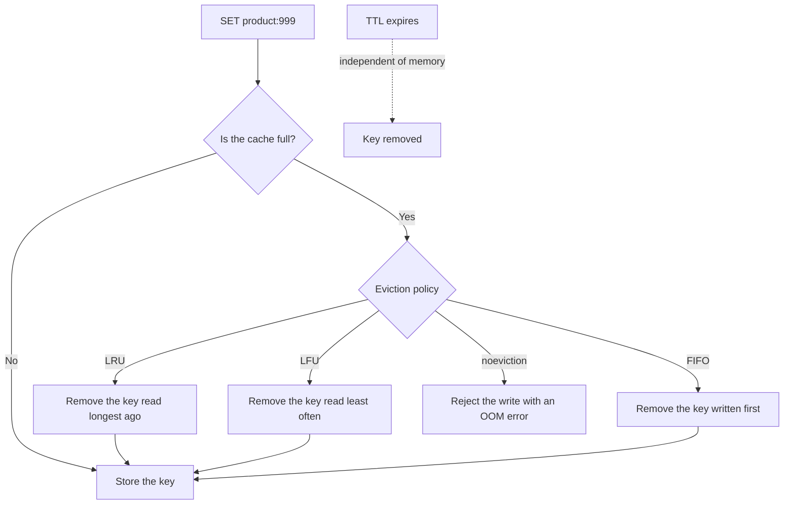

### Which one should I use?

My recommendation: **set a TTL on every key and use LRU for eviction**. The TTL keeps data fresh and LRU keeps memory under control. Switch to LFU only when you can see that a small set of keys gets most of the traffic.

In Redis this is two lines in `redis.conf`:

```
maxmemory 2gb
maxmemory-policy allkeys-lru
```

Watch out for the defaults. Open source Redis ships with `maxmemory-policy noeviction`, which means when memory is full Redis doesn't evict anything. It rejects every new write with an `OOM command not allowed` error. Managed services can differ. On AWS ElastiCache you set the policy in the parameter group, and the default there is `volatile-lru`, which only evicts keys that have a TTL.

| Policy         | What it evicts                                | Use when                                            |
| -------------- | --------------------------------------------- | --------------------------------------------------- |
| `allkeys-lru`  | Any key, least recently used first            | Redis is only a cache (the sensible default)        |
| `allkeys-lfu`  | Any key, least frequently used first          | A few hot keys get most of the reads                |
| `volatile-lru` | Only keys with a TTL, LRU first               | Redis holds cache data and data you must never lose |
| `volatile-ttl` | Only keys with a TTL, closest to expiry first | You want the TTL to decide what goes first          |
| `noeviction`   | Nothing, writes fail when full                | Redis is your database or a queue, not a cache      |

## Problems with caching

### Cache stampedes

Let's say we cache the homepage feed with a TTL of 60 seconds, and the homepage gets 100k requests every second. While the feed is in the cache, everything is great. Every request is a cache hit and the database barely notices.

Then the 60 seconds are up and the key expires. The next request misses the cache, so it goes to the database to rebuild the feed. But that query takes, say, 200ms, and in those 200ms another 20,000 requests arrive. None of them find the feed in the cache either, so all 20,000 send the same query to the database at the same time. The database falls over under the load, the queries get slower, more requests pile up behind them, and you end up with an outage.

This is called a cache stampede (or the thundering herd problem).

There are three common ways to prevent this:

1. Request coalescing: When multiple requests try to rebuild the same cache key at the same time, only the first request rebuilds it. The rest of the requests wait for that rebuild to finish and share its result. 20,000 requests that miss the homepage feed turn into 1 database query instead of 20,000.

Pros:

- Fixes the stampede with very little code
- The data is always fresh. Nobody gets served a stale copy
- Built into a lot of libraries already. In .NET 9+ `HybridCache` does this for you (we used it in the Read-Through section)

Cons:

- Every request that arrives during the rebuild still has to wait for it. If the DB query takes 5 seconds, those users wait 5 seconds
- If the rebuild fails, every waiting request gets an error
- An in-process version only coalesces requests on the same server. With 10 API instances you get 10 queries instead of 1 (still a lot better than 20,000). Coalescing across every instance needs a distributed lock

C# example:

```csharp
public class CoalescingCache(IConnectionMultiplexer redis)
{
    private readonly ConcurrentDictionary<string, Lazy<Task<string>>> _inFlight = new();

    public async Task<T> GetAsync<T>(string key, TimeSpan ttl, Func<Task<T>> load)
    {
        var cache = redis.GetDatabase();

        var cached = await cache.StringGetAsync(key);
        if (cached.HasValue)
        {
            return JsonSerializer.Deserialize<T>(cached!)!;
        }

        var rebuild = _inFlight.GetOrAdd(key, _ => new Lazy<Task<string>>(async () =>
        {
            try
            {
                var json = JsonSerializer.Serialize(await load());
                await cache.StringSetAsync(key, json, ttl);
                return json;
            }
            finally
            {
                _inFlight.TryRemove(key, out _);
            }
        }));

        return JsonSerializer.Deserialize<T>(await rebuild.Value)!;
    }
}
```

`GetOrAdd` with a `Lazy` makes sure only one rebuild is created per key. Every request that misses gets the same `Task` and awaits it. When the rebuild finishes, the key is removed from `_inFlight` so the next miss (after the TTL expires) starts a new one.

2. Cache warming: Instead of waiting for keys to expire, we proactively refresh them before they expire. For keys we know are hot, such as the homepage feed, the cache never actually expires (since we proactively refresh it), so a stampede never occurs in the first place.

Pros:

- Users never wait for a rebuild. Every request is a cache hit
- The database load is predictable: one query every N seconds, no matter how much traffic you get
- Simple to reason about. The refresh happens in one place on a schedule

Cons:

- Only works for keys you know about in advance. You can't warm every product page or every user's feed
- Wastes work refreshing data nobody is reading (at 3am the homepage still gets rebuilt every 45 seconds)
- If the warmer stops (it crashes or the deploy breaks it), a stampede will happen once the TTL runs out. Make the TTL a few times longer than the refresh interval to give yourself a buffer
- Every API instance running the warmer means every instance refreshes the same key. Run it as a single worker or set up a distributed lock first

C# example:

```csharp
public class HomepageFeedWarmer(
    IServiceScopeFactory scopes,
    IConnectionMultiplexer redis,
    ILogger<HomepageFeedWarmer> logger) : BackgroundService
{
    private static readonly TimeSpan RefreshEvery = TimeSpan.FromSeconds(45);
    private static readonly TimeSpan Ttl = TimeSpan.FromMinutes(5);

    protected override async Task ExecuteAsync(CancellationToken ct)
    {
        using var timer = new PeriodicTimer(RefreshEvery);

        do
        {
            try
            {
                using var scope = scopes.CreateScope();
                var feed = await scope.ServiceProvider.GetRequiredService<FeedService>().BuildHomepageAsync(ct);
                await redis.GetDatabase().StringSetAsync("homepage:feed", JsonSerializer.Serialize(feed), Ttl);
            }
            catch (Exception ex) when (ex is not OperationCanceledException)
            {
                logger.LogError(ex, "Failed to warm the homepage feed, retrying on the next tick");
            }
        } while (await timer.WaitForNextTickAsync(ct));
    }
}

builder.Services.AddHostedService<HomepageFeedWarmer>();
```

The feed is rebuilt every 45 seconds but the key lives for 5 minutes. If a few refreshes fail in a row, users still get a slightly older feed and the database is safe.

3. Stale-while-revalidate: This is very similar to request coalescing and something I've seen used when it takes a long time to rebuild a cache entry. The first request rebuilds the cache, but all the other requests get served a stale copy of the data in the meantime. I much prefer this option as clients get instant (but slightly stale) responses while we rebuild the cache in the background. It's the same idea as the `stale-while-revalidate` header from the Client-Side Caching section, just inside our own cache.

The trick is to store two expiry times. A "fresh until" time inside the value itself, and a much longer TTL on the Redis key. Once the fresh time passes, the data is stale but still in Redis, so we can keep serving it while one request refreshes it.

Pros:

- No user ever waits for a rebuild, even on a slow query
- Only one request rebuilds the key, across every instance, because the lock lives in Redis
- If the database is down, you keep serving the last good copy instead of errors

Cons:

- Users see stale data for a short time after it changes. Fine for something like a social media feed, not good for stock prices or credit card balances
- More moving parts: two expiry times, a lock and a background refresh
- Doesn't help on a cold cache. If the key isn't in Redis at all (after a flush for example), there's no stale copy to serve. Combine it with request coalescing for this case

C# example:

```csharp
public record CacheEntry<T>(T Value, DateTimeOffset FreshUntil);

public class StaleWhileRevalidateCache(IConnectionMultiplexer redis, ILogger<StaleWhileRevalidateCache> logger)
{
    private static readonly TimeSpan FreshFor = TimeSpan.FromSeconds(60);
    private static readonly TimeSpan KeepFor = TimeSpan.FromMinutes(10);
    private static readonly TimeSpan LockFor = TimeSpan.FromSeconds(30);

    public async Task<T> GetAsync<T>(string key, Func<CancellationToken, Task<T>> load, CancellationToken ct = default)
    {
        var cache = redis.GetDatabase();
        var cached = await cache.StringGetAsync(key);

        if (!cached.HasValue)
        {
            return await RefreshAsync(key, load, ct);
        }

        var entry = JsonSerializer.Deserialize<CacheEntry<T>>(cached!)!;

        if (entry.FreshUntil < DateTimeOffset.UtcNow &&
            await cache.StringSetAsync($"{key}:lock", "1", LockFor, When.NotExists))
        {
            _ = Task.Run(async () =>
            {
                try
                {
                    await RefreshAsync(key, load, CancellationToken.None);
                }
                catch (Exception ex)
                {
                    logger.LogError(ex, "Background refresh failed for {Key}", key);
                }
            });
        }

        return entry.Value;
    }

    private async Task<T> RefreshAsync<T>(string key, Func<CancellationToken, Task<T>> load, CancellationToken ct)
    {
        var cache = redis.GetDatabase();
        var value = await load(ct);
        var entry = new CacheEntry<T>(value, DateTimeOffset.UtcNow.Add(FreshFor));

        await cache.StringSetAsync(key, JsonSerializer.Serialize(entry), KeepFor);
        await cache.KeyDeleteAsync($"{key}:lock");

        return value;
    }
}
```

```csharp
app.MapGet("/", (StaleWhileRevalidateCache cache, IServiceScopeFactory scopes) =>
    cache.GetAsync("homepage:feed", async token =>
    {
        using var scope = scopes.CreateScope();
        return await scope.ServiceProvider.GetRequiredService<FeedService>().BuildHomepageAsync(token);
    }));
```

`SET key:lock 1 NX EX 30` only succeeds for one request across all of our servers, so only that _single request_ starts the refresh. Everyone else (including that request) gets the stale copy straight away. If the refresh crashes, the lock expires on its own after 30 seconds and the next request tries again.

### Hot keys

A hot key is a cache entry that gets way more traffic than any other cache entry. Even if your overall cache hit rate is healthy, this single key can become a big bottleneck. Imagine we're building Twitter and everyone is viewing Katy Perry's profile. The cache key for her profile could be receiving millions of requests a second. Even though our cache hit rate is good, _our cache is not healthy_.

The reason one key can hurt so much is how Redis scales. In a Redis cluster, every key is hashed to a slot, and every slot lives on exactly one shard. So `profile:katyperry` always lives on the same shard, no matter how many shards we add. Redis runs commands on a single thread, so a node can only handle so many operations a second, and its network card can only deal with so much egress. Every request for Katy Perry's profile hits that one node. The node's CPU sits at 100%, every other key that happens to live on the same shard gets slow, and the rest of the cluster sits idle.

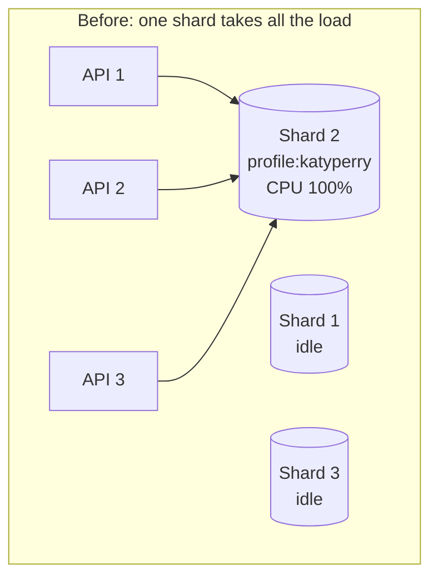

How to find hot keys:

Before you fix a hot key, you need to know which key is hot. Redis can tell you with `redis-cli --hotkeys`, which needs an LFU eviction policy (`allkeys-lfu`) so Redis tracks how often each key is read. The other signal is uneven load. If one shard's CPU is at 90% while the others sit at 20%, you probably have a hot key.

How to fix this:

- Replicate the hot keys: If everyone is trying to find out about Katy Perry's new album, we can store several copies of her cached profile under different keys, such as `profile:katyperry:copy:0` to `profile:katyperry:copy:7`. Each key name hashes to its own slot, so the copies usually end up spread across our shards. On every read the app picks a copy at random, so the load is spread evenly across the nodes. Writes have to update every copy. Redis read replicas are another option. They spread reads for the same key across several replica nodes, at the cost of slightly stale reads while replication catches up.

- In-memory caching: To reduce the load on Redis, we can skip it entirely for hot keys. We use the in-memory caching we talked about earlier to keep a copy right next to our server, with a very short TTL (a second or two). With 50 API instances, Redis now sees about 50 requests every 2 seconds for her profile instead of millions a second. The trade-off is that each server can be up to 2 seconds behind, which is usually fine if your workload is fine with eventual consistency

In practice you use both together. The local cache absorbs almost all of the traffic, and the copies spread out what's left.

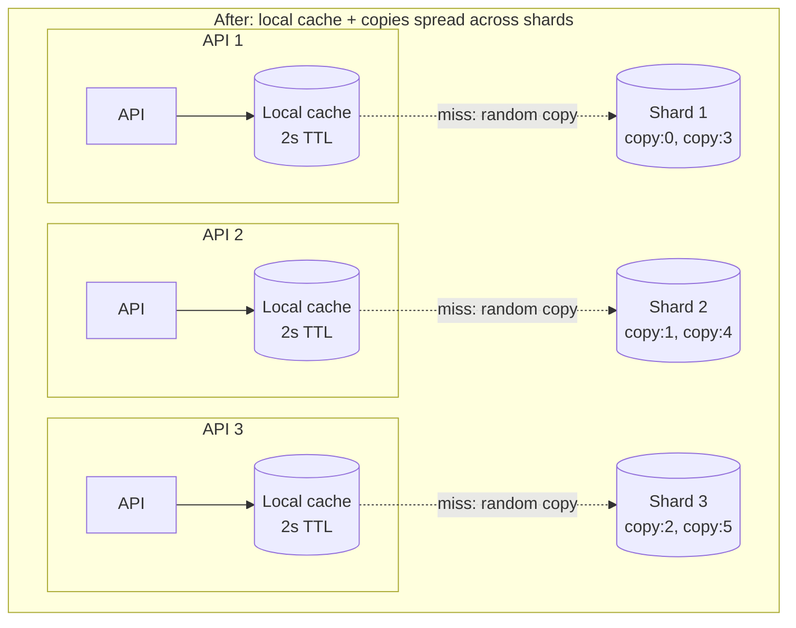

C# example:

```csharp
public class HotKeyCache(IConnectionMultiplexer redis, IMemoryCache local)
{
    private const int Copies = 8;
    private static readonly TimeSpan LocalTtl = TimeSpan.FromSeconds(2);
    private static readonly TimeSpan RedisTtl = TimeSpan.FromMinutes(10);

    public async Task<string?> GetAsync(string key)
    {
        if (local.TryGetValue(key, out string? value))
        {
            return value;
        }

        var copy = $"{key}:copy:{Random.Shared.Next(Copies)}";
        value = await redis.GetDatabase().StringGetAsync(copy);

        if (value is not null)
        {
            local.Set(key, value, LocalTtl);
        }

        return value;
    }

    public Task SetAsync(string key, string value)
    {
        var db = redis.GetDatabase();

        return Task.WhenAll(Enumerable.Range(0, Copies)
            .Select(i => db.StringSetAsync($"{key}:copy:{i}", value, RedisTtl)));
    }
}
```

```csharp
var profile = await hotKeys.GetAsync("profile:katyperry");
```

A read first checks the local cache. If it misses, it picks one of the 8 copies at random and caches it locally for 2 seconds. A write updates all 8 copies. Local caches on each server pick up the change within 2 seconds when their entry expires.

Only use this for keys you know are hot. If every key goes through it, every write becomes 8 writes and every server holds a local copy of everything. And if Redis has no copy at all, `GetAsync` returns `null` and the caller has to go to the database. For a hot key, that miss is going to cause a cache stampede, so protect the cache rebuild with one of the fixes from the section above.

#### Invalidating hot keys

Replicating a hot key makes reads cheap but invalidation harder. One write to Katy Perry's profile now has to update 8 copies in Redis _and_ the local cache on every API server. With 50 servers, that's 58 places the old profile can be hiding.

There are a few rules that make this manageable:

1. Overwrite, don't delete: In the cache-aside section we deleted the key on a write so the next read loads fresh data. Deleting all 8 copies here means the next million requests all miss at once and as you may have guessed, this will create a cache stampede. Instead, write the new value over every copy so there's never a moment where the key is missing.

2. Let the local TTL do most of the work: Each server's local copy only lives for 2 seconds, so the worst case without doing anything else is that a server serves the old profile for 2 seconds.

3. Broadcast an invalidation for local caches: If 2 seconds is too long, publish a message on a Redis pub/sub channel after the write. Every API server subscribes to that channel and removes the key from its local cache as soon as the message arrives. Pub/sub is fire and forget though. If a server is disconnected for a moment it can miss the message, so always keep the short TTL as a safety net.

4. Version every write: The 8 copies live on different shards, so we can't update them all in one transaction. If two writes happen at the same time, `copy 0` could end up with the newer profile and `copy 1` with the older one, and users would see the profile flip between versions on every refresh. To fix this, we take a version number from Redis (`INCR`) on every write, store it with the value and only let a copy be overwritten by a higher version.

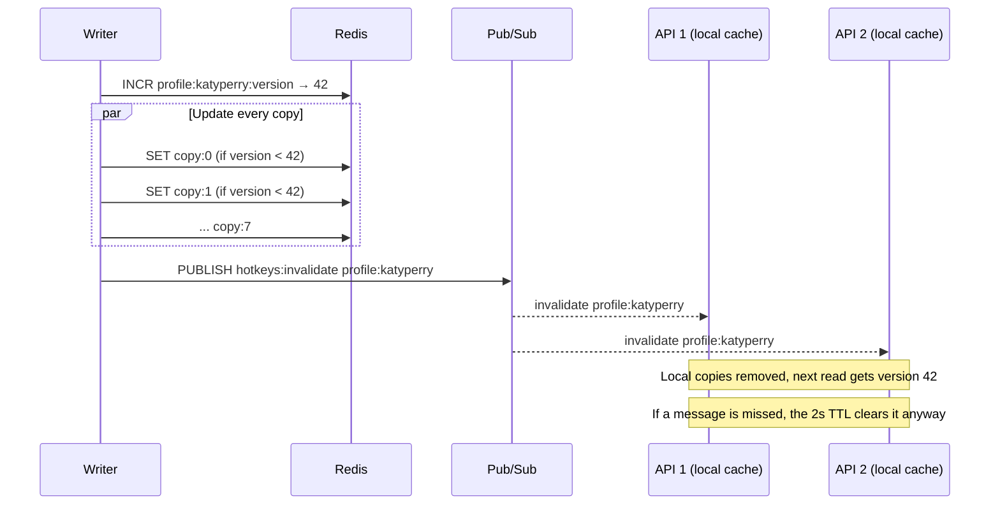

Here's the `HotKeyCache` from above with versioning and pub/sub invalidation added:

```csharp
public record Versioned(long Version, string Value);

public class HotKeyCache
{
    private const int Copies = 8;
    private const string Channel = "hotkeys:invalidate";
    private static readonly TimeSpan LocalTtl = TimeSpan.FromSeconds(2);
    private static readonly TimeSpan RedisTtl = TimeSpan.FromMinutes(10);

    private static readonly LuaScript SetIfNewer = LuaScript.Prepare("""
        local current = redis.call('GET', @key)
        if current and cjson.decode(current).Version >= tonumber(@version) then
            return 0
        end
        redis.call('SET', @key, @value, 'EX', @ttl)
        return 1
        """);

    private readonly IConnectionMultiplexer _redis;
    private readonly IMemoryCache _local;

    public HotKeyCache(IConnectionMultiplexer redis, IMemoryCache local)
    {
        _redis = redis;
        _local = local;

        redis.GetSubscriber().Subscribe(
            RedisChannel.Literal(Channel),
            (_, key) => _local.Remove(key.ToString()));
    }

    public async Task<string?> GetAsync(string key)
    {
        if (_local.TryGetValue(key, out Versioned? cached))
        {
            return cached!.Value;
        }

        var json = await _redis.GetDatabase().StringGetAsync(CopyKey(key, Random.Shared.Next(Copies)));
        if (json.IsNull)
        {
            return null;
        }

        var entry = JsonSerializer.Deserialize<Versioned>(json.ToString())!;
        _local.Set(key, entry, LocalTtl);
        return entry.Value;
    }

    public async Task SetAsync(string key, string value)
    {
        var db = _redis.GetDatabase();
        var version = await db.StringIncrementAsync($"{key}:version");
        var json = JsonSerializer.Serialize(new Versioned(version, value));

        await Task.WhenAll(Enumerable.Range(0, Copies).Select(i =>
            SetIfNewer.EvaluateAsync(db, new
            {
                key = (RedisKey)CopyKey(key, i),
                version,
                value = json,
                ttl = (long)RedisTtl.TotalSeconds,
            })));

        await _redis.GetSubscriber().PublishAsync(RedisChannel.Literal(Channel), key);
    }

    private static string CopyKey(string key, int copy) => $"{key}:copy:{copy}";
}
```

`SetIfNewer` runs as a Lua script. This is so that the read, compare and write on each copy happen as one atomic step. Each script only touches one key, so it works fine in a Redis cluster even though the copies live on different shards. If two writers race each other, the one with the higher version will always win on every copy.

There's still one small gap. A server can read an old copy from Redis just before the write lands and then put it in its local cache just after the invalidation message arrived. That server serves the old profile until its local TTL runs out. That's why the TTL stays short: no matter what goes wrong, nothing is stale for more than 2 seconds.

### Cache consistency

The cache and the database can return different values for the same data. It's super easy for this to happen. Most systems read from the cache and write to the database, which creates a short window where the cache holds stale data. Let's use the Twitter example again. A user updates their profile picture. The new picture is written to the database, but the old one is still in the cache. So other users hit the cache and get the old photo, even though we've updated the database. This keeps happening until the old value in the cache expires or is evicted. There's no perfect solution for this. It depends on how fresh you need the data to be.

Common ways to fix this:

- **Invalidate on write**: When the picture gets updated, we also delete that cache entry. The next request gets a cache miss and loads the new picture from the database. This still has a small race. A slow read can fetch the old picture from the database just before the write, then put it back in the cache just after we deleted it. Facebook hit this at scale and solved it with leases: on a cache miss, memcache hands the reader a token, and it only accepts the reader's write if the key hasn't been deleted in the meantime.
- **Short TTLs**: If we're not too bothered about some stale data, we can cache it with a short expiry so it's never stale for long. If the data changes often, this is usually good enough.
- **Accept eventual consistency**: For a lot of data, it's fine for the cache to be a little behind as long as it catches up eventually. A profile picture that takes 30 seconds to update everywhere is not a problem.

## Closing thoughts

If I had to boil this post down to a few rules:

- Measure first. Find the queries that cost you the most in total, and fix slow queries and missing indexes before you reach for a cache.
- Start simple. Cache-aside with a TTL on every key and an LRU eviction policy covers most workloads. Only reach for write-through, write-behind or read-through when you have a specific reason to.
- Cache in layers. A CDN for public responses, an in-memory cache for small hot data and Redis for everything shared between servers. Each layer takes load off the one behind it.
- Plan for the bad day. Protect hot keys from stampedes, keep an eye on hot keys, and make sure your app still works (slower) if the cache disappears completely.
- Watch your metrics. Hit rate, evictions, memory usage and CPU per shard tell you if your cache is healthy long before your users do.

Most of the problems in this post (stampedes, hot keys, stale data) only show up under heavy traffic. The good news is that none of them are new. Facebook's memcache paper and the AWS caching whitepaper below cover a lot of these problems at a scale most of us will never need.

## Sources

- [Two Hard Things - Martin Fowler](https://martinfowler.com/bliki/TwoHardThings.html)
- [Latency numbers every programmer should know](https://gist.github.com/jboner/2841832)
- [pg_stat_statements - PostgreSQL documentation](https://www.postgresql.org/docs/current/pgstatstatements.html)
- [Cache-Control - MDN](https://developer.mozilla.org/en-US/docs/Web/HTTP/Headers/Cache-Control)
- [ETag - MDN](https://developer.mozilla.org/en-US/docs/Web/HTTP/Headers/ETag)
- [RFC 9111: HTTP Caching](https://www.rfc-editor.org/rfc/rfc9111)
- [RFC 5861: HTTP Cache-Control Extensions for Stale Content](https://www.rfc-editor.org/rfc/rfc5861)
- [persistQueryClient - TanStack Query](https://tanstack.com/query/latest/docs/framework/react/plugins/persistQueryClient)
- [HybridCache library in ASP.NET Core - Microsoft Learn](https://learn.microsoft.com/en-us/aspnet/core/performance/caching/hybrid)
- [Database Caching Strategies Using Redis - AWS whitepaper](https://docs.aws.amazon.com/whitepapers/latest/database-caching-strategies-using-redis/welcome.html)
- [Engine specific parameters - Amazon ElastiCache](https://docs.aws.amazon.com/AmazonElastiCache/latest/dg/ParameterGroups.Engine.html)
- [Key eviction - Redis documentation](https://redis.io/docs/latest/develop/reference/eviction/)
- [Redis cluster specification](https://redis.io/docs/latest/operate/oss_and_stack/reference/cluster-spec/)
- [Redis CLI - Redis documentation](https://redis.io/docs/latest/develop/tools/cli/)
- [Redis Pub/Sub - Redis documentation](https://redis.io/docs/latest/develop/interact/pubsub/)
- [Pay for file invalidation - Amazon CloudFront](https://docs.aws.amazon.com/AmazonCloudFront/latest/DeveloperGuide/PayingForInvalidation.html)
- [Use managed cache policies - Amazon CloudFront](https://docs.aws.amazon.com/AmazonCloudFront/latest/DeveloperGuide/using-managed-cache-policies.html)
- [London to Sydney latency - Hats Network](https://hatsnet.io/docs/network/latency/pairs/lon-syd-rtt)
- [Scaling Memcache at Facebook - Nishtala et al., NSDI 2013](https://www.usenix.org/conference/nsdi13/technical-sessions/presentation/nishtala)
